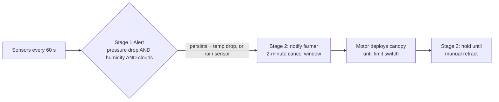
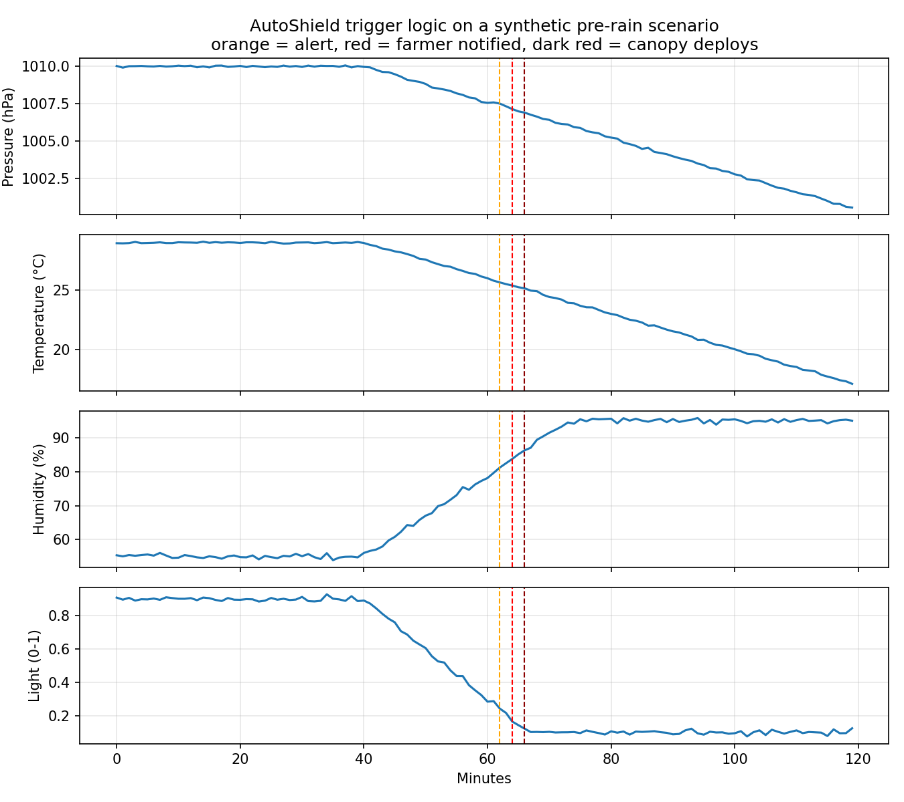

# AutoShield

**Smart sensor-triggered motorized canopy for protecting crops against unseasonal rainfall and hailstorms.**

[](https://github.com/YOUR_USERNAME/AutoShield/actions)


AutoShield is an IoT crop-protection system for high-value horticultural crops (grape, pomegranate, strawberry, flowers). An ESP32 fuses barometric pressure, temperature, humidity, light and rain-sensor data to detect imminent rainfall and automatically deploys a PVC-coated polyester canopy over the field. It runs fully offline on solar power, collects rainwater, and offers optional mobile control.

This repository contains the **research paper**, the **reference firmware**, a **tested simulation of the trigger logic**, and **hardware, economic and architecture documentation**.

> 📄 **Paper:** [`docs/AutoShield_Research_Paper.pdf`](docs/AutoShield_Research_Paper.pdf)

---

## Why AutoShield?

Unseasonal rain during the 20-25 day harvest window can destroy a season's produce (INR 5-12 lakh per acre for grape and pomegranate farmers). Manual tarpaulins are slow and labour-intensive, greenhouses cost INR 5-20 lakh per acre, and imported retractable roofs cost more than USD 50,000. AutoShield targets the gap: automatic, affordable (INR 15,000-80,000 per unit as estimated in the paper's abstract), offline-first and modular.

## Key features

- **Three-stage sensor-fusion trigger** (BMP280 + DHT22 + LDR + rain sensor) that reduces false deployments
- **Gravity-assisted counterweight mechanism** (~60 % of canopy weight) cutting motor energy by about 55 %
- **Offline-first** control; Bluetooth/WiFi dashboard and WhatsApp alerts are optional extras
- **Off-grid power:** 50 W solar panel + 12 V 20 Ah battery (200+ hours of standby)
- **Integrated rainwater harvesting** through gutters and pillar pipes
- **Modular units** from 20x20 ft to 100x100 ft with fault isolation

## Prototype results (from the paper)

| Metric | Target | Achieved |
|---|---|---|
| Deployment time (trigger to full open) | < 120 s | 78 s average |
| Rain prediction lead time | > 10 min | 15-40 min |
| False trigger rate (multi-sensor) | < 1 / week | 0.5 / week |
| Battery life (standby, no solar) | > 100 h | 218 h |
| Water collection efficiency | > 80 % | 87 % |
| Manual override response | < 5 s | 2.3 s |

Phase 2 testing (6x6 ft functional model): 2 false triggers in 30 days with multi-sensor logic versus 11 with temperature alone.

## How it works



Details: [architecture](docs/architecture.md) · [trigger logic](docs/trigger-logic.md) · [hardware guide](docs/hardware-guide.md) · [economics](docs/economics.md)



*Trigger logic on a synthetic pre-rain scenario (generated by `simulation/demo.py`, not field data).*

## Repository structure

```
AutoShield/
├── docs/                   Paper (PDF), architecture, trigger logic, hardware guide, economics
├── firmware/
│   ├── autoshield/         ESP32 Arduino sketch, config.h, trigger_logic.h
│   └── test/               Native C++ unit tests for the trigger logic
├── simulation/             Python reference model, demo plot and pytest suite
├── hardware/bom.csv        Bill of materials
├── .github/                CI workflow, issue and PR templates
├── SAFETY.md  CONTRIBUTING.md  CHANGELOG.md  CITATION.cff  LICENSE
```

## Getting started

### 1. Run the simulation (no hardware needed)

```bash
git clone https://github.com/YOUR_USERNAME/AutoShield.git
cd AutoShield/simulation
pip install -r requirements.txt
pytest -q
python demo.py
```

### 2. Run the firmware logic tests on your PC

```bash
g++ -std=c++11 -Wall -Wextra -o /tmp/test_logic firmware/test/test_trigger_logic.cpp && /tmp/test_logic
```

### 3. Flash an ESP32

1. Install the Arduino IDE with the **esp32** board package.
2. Install libraries: *DHT sensor library*, *Adafruit Unified Sensor*, *Adafruit BMP280 Library*.
3. Open `firmware/autoshield/autoshield.ino`, adjust pins in `config.h`, select **ESP32 Dev Module** and upload.
4. Open the Serial Monitor at 115200 baud. Commands: `d` deploy, `r` retract, `x` cancel pre-deploy, `s` status.

> ⚠️ Bench-test with the motor **disconnected** first and read [SAFETY.md](SAFETY.md).

## Implementation status

| Component | Status |
|---|---|
| Three-stage trigger logic (C++ and Python) | ✅ Implemented and unit-tested |
| ESP32 control loop, motor + limit switches, SPIFFS logging, manual override | ✅ Reference implementation (compile-checked; not validated on hardware in this repo) |
| Mobile app (Bluetooth/WiFi) | ⏳ Not included |
| WhatsApp alerts, OpenWeatherMap integration | ⏳ Hook (`notifyFarmer()`) only |
| Anemometer wind-retract, multi-unit mesh | ⏳ Planned |

## Limitations

- Results come from small-scale prototypes (up to 6x6 ft); full-scale wind loading and hail behaviour still need field validation.
- Trigger thresholds are generic and should be tuned with local weather data (see [trigger-logic.md](docs/trigger-logic.md#known-limitations)).
- The reference firmware is not a certified safety system. Do not rely on it as the sole protection of a structure or crop.

## Roadmap

- [ ] AI-based rainfall prediction trained on local historical weather data
- [ ] IMD API integration for 24-48 h district-level forecasts
- [ ] Soil-moisture sensing for post-rain irrigation
- [ ] LoRa long-range farm-to-farmhouse link
- [ ] ESP32-CAM crop disease/pest detection
- [ ] Multi-unit mesh coordination
- [ ] Mobile app and WhatsApp notifications

## Citation

If you use this work, please cite it (see [`CITATION.cff`](CITATION.cff); GitHub shows a "Cite this repository" button):

> Sonewane, P. M. (2026). *AutoShield: Smart Sensor-Triggered Motorized Canopy System for Crop Protection Against Unseasonal Rainfall and Hailstorm Events.*

## Contributing and license

Contributions, especially **field-test data**, are welcome: see [CONTRIBUTING.md](CONTRIBUTING.md). Code is released under the [MIT License](LICENSE); the paper and documentation under CC BY 4.0 (see [LICENSE-DOCS.md](LICENSE-DOCS.md)).

**Author:** Pradyumna Murlidhar Sonewane · Nagpur, Maharashtra, India
=======
ESP32-based IoT crop protection system: multi-sensor fusion (BMP280, DHT22, LDR, rain) triggers a solar-powered motorized canopy against unseasonal rain and hail. Includes research paper, reference firmware, tested trigger-logic simulation, BOM and docs. 
>>>>>>> 14bc699ebd048d156264f6f673868331f3dde7b4
