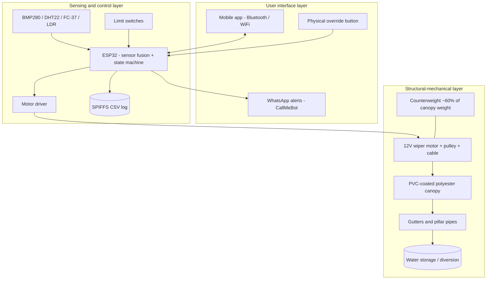
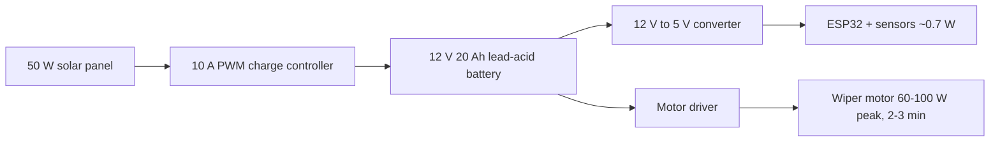
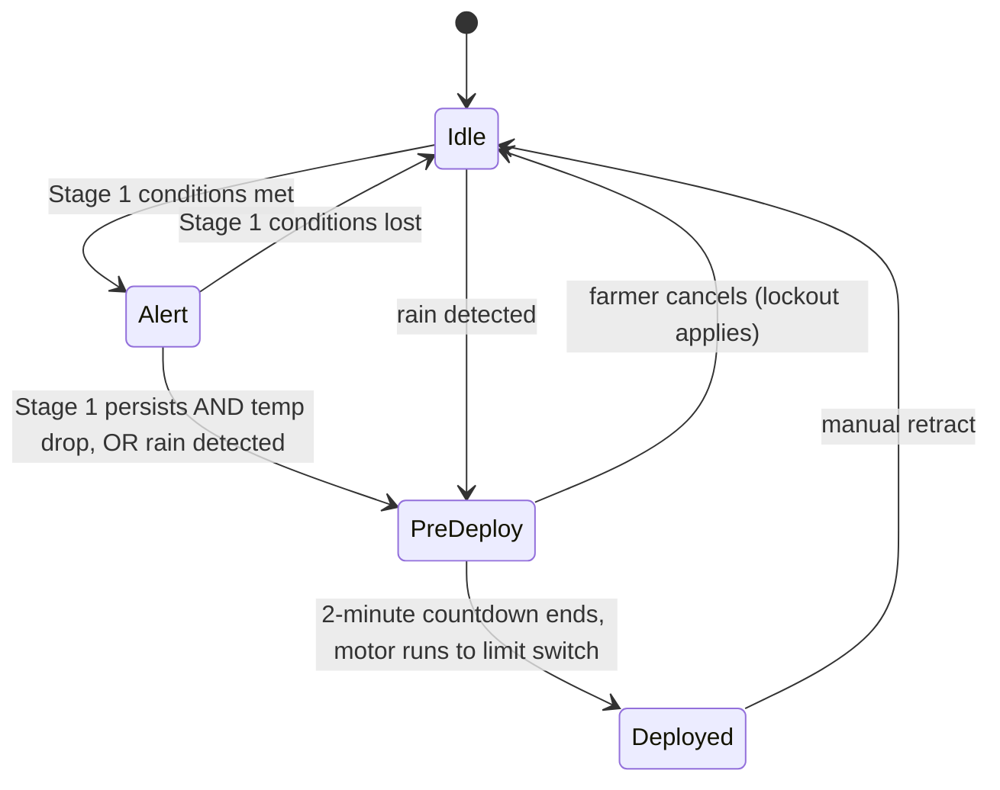

# System Architecture

AutoShield has three layers (paper Section 3): structural-mechanical, sensing & control, and user interface.

## Layers

## Power

Battery energy: 12 V x 20 Ah = 240 Wh. At under 1 W standby this exceeds 200 hours without solar input (218 h measured in the paper).

## Trigger state machine

See [trigger-logic.md](trigger-logic.md) for thresholds, interpretation notes and assumptions.
